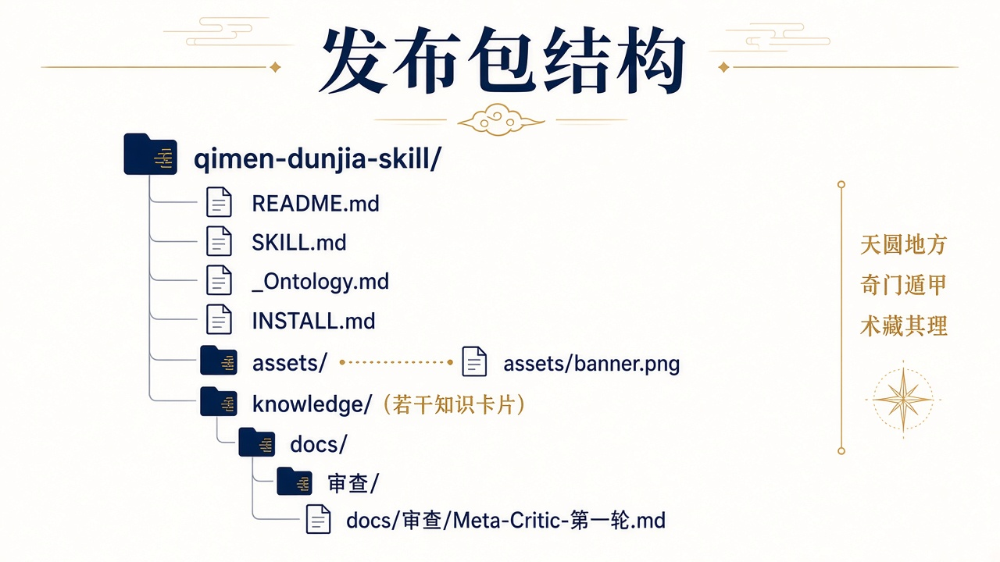

# 奇门遁甲 Skill（带精简 Ontology 底座）


> 把《奇门遁甲笔记》蒸馏成 **211 张知识卡**，再用一份 **关系规则表（Ontology）** 把卡与卡之间怎么挂、起断局按什么顺序，写清楚。装进支持 Skills 的 Agent 后，可查概念、可跟步骤、跨卡问题先读关系层。


**支持：WorkBuddy、Claude Code、Codex，以及其他能加载 `SKILL.md` 的 Agent。**

本仓库是「底座 + Skill」形态：**单元（知识卡）+ 本体（关系表）+ 可检索载体（本仓库文件）**。

| | |
| --- | --- |
| 知识卡 | **211** 张，一文一概念，含使用规则 / 原文依据 |
| 关系层 | `_Ontology.md`：结构 / 程序 / 应用 + 同指异名 + 不确定分区 |
| Skill 入口 | `SKILL.md`（`name: qimen-dunjia`） |

[上手三步](#上手三步) · [能解决什么](#能解决什么) · [包里有什么](#包里有什么) · [怎么装](#怎么装) · [已知缺口](#已知缺口) · [免责声明](#免责声明)

## 上手三步

装好并**彻底重启** Agent 后，直接问：

```text
空亡是什么
```

能按知识卡作答、并注明依据哪张卡 → 装成功。

再验底座（关系层）：

```text
这一局值使落在庚上，该怎么断？
```

能说出该挂「奇仪值门 / 太白刑门」一类关系，并说明判据是「值使加临哪个地盘干」→ 关系层生效。

起一局（自行核三处：定局 / 旬首 / 值使落宫）：

```text
现在起一局，时间 2026-10-13 01:32，把起局十步逐步写出来
```

## 能解决什么

| 你现在想问 | 它怎么答 |
| --- | --- |
| 某个概念是什么（如空亡、八门） | 查 `knowledge/` 对应卡，按「使用规则」答，并注明出处 |
| 起局十步怎么走 | 先读 `_Ontology.md` §3.1，再回卡片取证 |
| 断局按什么顺序看 | `_Ontology.md` §3.2 断局五段 |
| 这类事该取哪个用神 | `_Ontology.md` §4.2 分类占 |
| 两个词是不是一回事 | `_Ontology.md` §5 同指异名 |
| 资料里没有的内容 | 应直说「我掌握的资料里没有」，不编造 |

## 包里有什么




| 路径 | 作用 |
| --- | --- |
| `SKILL.md` | Skill 入口：何时触发、怎么读卡、怎么读关系层 |
| `_Ontology.md` | 精简 Ontology：关系名必须具体，推断挂接不得当定论 |
| `knowledge/` | 211 张蒸馏卡（**勿拆散**，须与 `SKILL.md` 同包） |
| `INSTALL.md` | 安装说明（WorkBuddy 等宿主） |
| `assets/` | 封面与发布包结构图 |
| `docs/审查/` | 多轮交叉审查与改稿记录（Meta-Critic / 多维对比） |

## 怎么装

本 Skill 不是只给 WorkBuddy 用的。凡是能加载 `SKILL.md` 的 Agent / 宿主都可以装；下面按常见宿主写，你用哪个跟哪一段。

### 通用原则

把本仓库目录放到宿主的 skills 加载路径里，并保证这三者相对位置不变：

- `SKILL.md`
- `knowledge/`
- `_Ontology.md`

改完路径后，多数宿主需要**彻底退出再打开**才认得到新 Skill。

### WorkBuddy

1. 左侧「专家 · 技能 · 连接器」→「技能」→「+ 添加技能」
2. 把本仓库打成的 zip（或本目录打包）拖进弹窗
3. 完全退出 WorkBuddy 再打开（托盘右键退出；只关窗口不算）
4. 用上面「上手三步」验证

### Claude Code

任选其一：

```bash
# 方式 A：克隆到 Claude Code 可加载的 skills 目录（路径以你本机配置为准）
git clone https://github.com/Fenghuang-huoyan/qimen-dunjia-skill.git ~/.claude/skills/qimen-dunjia-skill
```

```bash
# 方式 B：已有目录时，软链过去
ln -s /path/to/qimen-dunjia-skill ~/.claude/skills/qimen-dunjia-skill
```

重启 Claude Code 会话后，直接问「空亡是什么」做验证。

### Codex / 其他支持 Skills 的 Agent

1. `git clone https://github.com/Fenghuang-huoyan/qimen-dunjia-skill.git`
2. 将整个目录放到该宿主文档标明的 skills 路径（名称可能是 `skills/`、`.agents/skills` 等）
3. 确认 `SKILL.md`、`knowledge/`、`_Ontology.md` 仍在同一层
4. 重启宿主后用「上手三步」验证

更细的安装说明（含常见坑）见 [`INSTALL.md`](INSTALL.md)。


## 关系层四条硬规矩

1. **推断 ≠ 原文**：§4.4 案例归属标「推断挂接」的，引用必须说明是推断。
2. **两说并存不得择一**：§6.1 条件并存条目，引用必须带条件。
3. **无格不许就近借名**：格表没有对应格，就说没有，不得套近义词。
4. **冲突以卡片为准**：关系层与卡片原文冲突时，以卡片为准。

## 已知缺口

原书有三块未蒸进卡，问到可能不全（属资料边界，不是安装坏了）：

- 晴雨用神的具体符号
- 8 个案例的完整推理过程
- 奇门九遁、三祚五假（原书后置章节）

## 目录长什么样


```text
qimen-dunjia-skill/
├── README.md          # 本说明
├── SKILL.md           # Skill 入口
├── _Ontology.md       # 精简关系表
├── INSTALL.md         # 安装说明
├── assets/
│   ├── banner.jpg     # 封面
│   └── structure.jpg  # 结构图
├── docs/
│   └── 审查/          # 两轮审查文档
└── knowledge/         # 211 张知识卡
```

## 免责声明

本 Skill 仅供学习与研究使用，内容蒸馏自《奇门遁甲笔记》。**不是**命理从业资质、医疗、法律或投资建议。据此做出的任何判断，责任在使用者自己。

## 审查与迭代

本 Skill 经过多轮交叉审查与改稿后发布。过程材料（Meta-Critic、多维对比）放在 `docs/审查/`，方便查阅改进依据；日常使用直接看 `SKILL.md`、`_Ontology.md` 与 `knowledge/` 即可。


## 授权

默认采用 [CC BY-NC 4.0](LICENSE)：个人学习、研究与非商业再分享。商业使用请另行取得授权，并确认原书授权边界。
